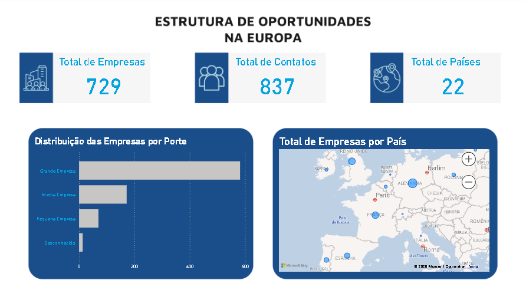
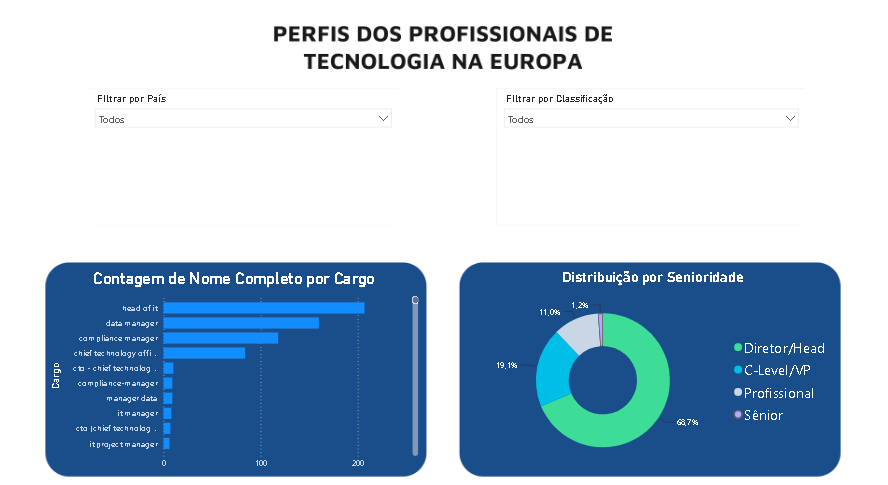
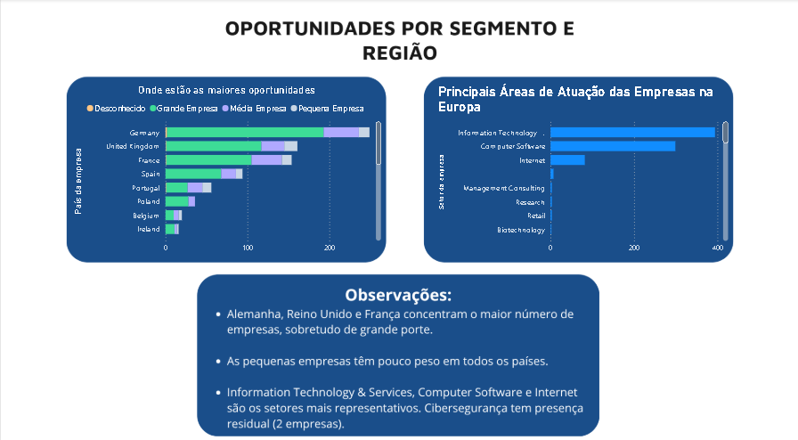

# Estratégia de Posicionamento da hCaptcha no Mercado Europeu

Dashboard interativo em **Power BI** que analisa uma base de potenciais clientes
para responder a uma pergunta de negócio: **como deveria a hCaptcha
posicionar-se no mercado europeu?**

> Projeto académico desenvolvido no curso de Análise de Dados e TI Aplicados à
> Gestão (Prepara Portugal). Não tem qualquer relação com a hCaptcha.

## Pergunta de negócio

Que perfis de profissionais, países, setores e portes de empresa devem ser
priorizados numa estratégia de entrada no mercado europeu?

## Dados

Base com cerca de 837 registos de profissionais de tecnologia, pertencentes a
729 empresas distintas (após limpeza), fornecida no âmbito do curso.
**A base não está incluída neste repositório**, por conter dados pessoais.

## Tratamento dos dados (Power Query)

- Remoção de colunas vazias e de campos redundantes (ex.: LinkedIn duplicado)
- Deduplicação por e-mail e nome completo
- Remoção de títulos nos nomes (ex.: PhD) e padronização de campos de texto
- Revisão de valores nulos e das colunas de país, cidade e localização
- Separação entre **país da empresa** (referência para a análise comercial) e
  localização do profissional (pode trabalhar remotamente para uma empresa
  de outro país)
- Manutenção dos registos com e-mail ou telefone em falta, porque o objetivo
  era análise de mercado e não uma campanha real
- Consolidação do porte das empresas: *Grande, Muito grande, Enorme* e
  *Enterprise* passaram a **Grande Empresa**; mantidas *Média*, *Pequena* e
  *Fora da faixa / Desconhecido*
- Criação da variável **Senioridade** (C-Level/VP, Diretor/Head, Sénior,
  Profissional) a partir do cargo; os cargos de *manager* foram agrupados em
  Diretor/Head
- Decisão deliberada de **não** criar uma classificação por área de atuação:
  a variedade de cargos e idiomas gerava ruído e risco de classificações erradas,
  pelo que os gráficos usam os cargos reais

## Dashboard (3 páginas)

| Página | Conteúdo |
|---|---|
| 1. Visão geral do mercado europeu | Indicadores (contactos, países, empresas), empresas por porte e mapa por país |
| 2. Perfil dos profissionais | Top 10 cargos e distribuição por senioridade, com filtros por país e porte |
| 3. Segmentos e oportunidades | Empresas por país e porte; setores mais representativos |

Foi seguido o padrão de leitura em "Z" para organizar a informação, com uma
paleta fria (azul escuro, turquesa, lilás e cinza claro) associada a tecnologia
e confiança. Os fundos foram criados no Canva.

## Principais conclusões

- A base é dominada por grandes empresas: 487 das 729 empresas distintas
  (cerca de 66,8%, arredondados para 67%), seguidas das médias (161), das pequenas
  (68) e das de porte desconhecido (13)
- Alemanha, Reino Unido e França lideram em número de empresas, com
  predominância de grandes empresas; as pequenas empresas têm peso reduzido em
  todos os países
- Os cargos mais frequentes são *head of IT*, *data manager* e *compliance
  manager*; 68,7% dos contactos classificados estão na categoria Diretor/Head (inclui
  cargos de *manager*) e 19,1% na categoria C-Level/VP; estas percentagens devem ser
  interpretadas tendo em conta eventuais registos sem senioridade atribuída
- Os setores mais representativos são Information Technology & Services,
  Computer Software e Internet, ou seja, empresas digitais que podem ter interesse
  em soluções de verificação de utilizadores e proteção contra bots e abuso automatizado
- Cibersegurança, o setor mais próximo do produto, aparece apenas em 9.º lugar
  (2 empresas), pelo que a base reflete sobretudo empresas de tecnologia em
  geral e não especialistas em segurança

Com base nestes resultados, a análise sugere priorizar, numa primeira fase exploratória,
empresas de tecnologia de grande porte na Alemanha, no Reino Unido e em França.
Esta prioridade deve ser validada com informação adicional sobre procura, concorrência
e potencial comercial, uma vez que a concentração de empresas na base não demonstra,
por si só, maior probabilidade de compra ou rentabilidade.

## Limitações

- Ao agrupar os cargos de *manager* em Diretor/Head, a proporção de
  decisores de topo pode estar sobrestimada; a variável serve para comparar
  níveis hierárquicos e não para medir poder de decisão
- A base não mede propensão real de compra, pelo que as conclusões indicam
  concentração de oportunidades e não probabilidade de adoção
- A contagem de empresas usa o nome tal como está escrito; variantes do mesmo
  nome contam como empresas distintas
- O argumento de conformidade com o RGPD/GDPR é uma hipótese de comunicação e
  não uma conclusão tirada dos dados
- Os totais referem-se à base completa; leituras por região dependem dos filtros
  aplicados
- O estudo utiliza «mercado europeu» num sentido geográfico amplo, incluindo países
  como o Reino Unido, que não pertence à União Europeia

## Metodologia resumida

O trabalho partiu da preparação e limpeza da base no Power Query, seguida da
criação de variáveis para análise, segmentação dos registos por país, porte e
senioridade e construção de indicadores e visualizações no Power BI. As conclusões
são exploratórias: descrevem os padrões observados na base disponibilizada e não
constituem uma previsão de conversão ou de procura real.

## Acesso ao dashboard

Este repositório apresenta capturas de ecrã das três páginas do dashboard. Caso o
ficheiro Power BI (`.pbix`) ou uma versão interativa sejam disponibilizados, os
respetivos links poderão ser acrescentados aqui. A base de dados original não é
incluída por conter dados pessoais.

## Ferramentas

Power BI · Power Query · Excel · Canva

## Competências demonstradas

Limpeza e qualidade de dados · Segmentação · KPIs · Filtros e segmentadores ·
Análise exploratória · Visualização de dados · Storytelling com dados
